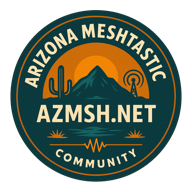

# Arizona Meshtastic Community

### Arizona's community-built Meshtastic network

Run a node, learn about radio, build useful tools, and help grow Arizona's off-grid mesh.

[Get connected](https://azmsh.net/docs/how-to-connect.html) · [Recommended hardware](https://azmsh.net/docs/recommended-hardware.html) · [Recommended settings](https://azmsh.net/docs/recommended-settings.html) · [Community channels](https://azmsh.net/docs/suggested_channels.html)

---

## 📡 Hi from the Arizona mesh

We're a group of people across Arizona who use and build around Meshtastic. Some of us are radio veterans, some write code, and some just bought their first node. Everyone is welcome.

Meshtastic uses small LoRa radios to send text messages and share locations. Nearby radios pass messages along, so the network can cover far more ground than one radio could on its own. It works without cell service, subscriptions, or monthly fees.

Here at AZMSH, we compare notes on what works in Arizona, help people set up their radios, and build tools for seeing what is happening on the mesh.

> **Just getting started?** Our [connection guide](https://azmsh.net/docs/how-to-connect.html) covers picking a radio, installing the app, joining Discord, and setting up your node for the Arizona mesh.

## 🛰️ What we're building

<table>
<tr>
<td width="50%" valign="top">

### 🗺️ [Sonoran](https://github.com/ArizonaMeshtasticCommunity/sonoran)

Our network dashboard for nodes, mesh links, traffic, telemetry, chat, coverage predictions, and signal planning.

**Python · TimescaleDB · Leaflet · ECharts**

</td>
<td width="50%" valign="top">

### 📻 [Sonoran Contributor](https://github.com/ArizonaMeshtasticCommunity/sonoran-contributor)

Lets members contribute local radio observations and mesh measurements to Sonoran using their own receivers.

**Python · MQTT · Meshtastic · SDR**

</td>
</tr>
<tr>
<td width="50%" valign="top">

### 🎓 [Educational Materials](https://github.com/ArizonaMeshtasticCommunity/edu-materials)

Presentations and practical guides for meetups, classes, and people setting up their first radio.

**Guides · Presentations · Community training**

</td>
<td width="50%" valign="top">

### 🌵 [AZMSH Website](https://github.com/ArizonaMeshtasticCommunity/azmsh-site)

The source for [azmsh.net](https://azmsh.net), including our setup guides, hardware notes, settings, channels, and node-hosting advice.

**MkDocs · Material · Community docs**

</td>
</tr>
<tr>
<td width="50%" valign="top">

### 🤖 [Meshtastic Cogs](https://github.com/ArizonaMeshtasticCommunity/Meshtastic-Cogs)

Discord tools that bridge mesh traffic, find nodes, show telemetry, and help run the community server.

**Python · Red-DiscordBot · MQTT**

</td>
<td width="50%" valign="top">

### 🧰 [Community Scripts](https://github.com/ArizonaMeshtasticCommunity/community-scripts)

Useful scripts and automation shared by AZMSH members.

**Open tools for the Arizona mesh**

</td>
</tr>
</table>

## 🚀 Join the mesh

1. **Choose a radio.** Read our [recommended hardware](https://azmsh.net/docs/recommended-hardware.html) guide for options from pocket-sized clients to outdoor solar nodes.
2. **Install Meshtastic.** Pair the radio with the official Android, iOS, or web app.
3. **Meet the community.** [Join the AZMSH Discord](https://discord.gg/HrKtyuFEQk) for the current Arizona configuration and friendly setup help.
4. **Configure your node.** Follow the [connection guide](https://azmsh.net/docs/how-to-connect.html) and [recommended settings](https://azmsh.net/docs/recommended-settings.html).
5. **Say hello.** Send a message over the mesh, take a look at [Sonoran](https://github.com/ArizonaMeshtasticCommunity/sonoran), and find your neighbors.

### `radio → neighbor → router → neighbor → destination`

**A well-placed node can help a lot of people around it.**

## 🏔️ Have a tower or high site?

Height makes a huge difference for radio coverage. We would love to work with tower owners, building managers, and people who have access to rooftops or other elevated sites. A well-placed node can connect communities that would otherwise be out of range.

If you have a possible site, read our [host a node guide](https://azmsh.net/docs/host-a-node.html) or come talk with us in [Discord](https://discord.gg/HrKtyuFEQk).

## 🗓️ Meet us on the air

| When | Where | What |
| --- | --- | --- |
| **Sunday · 5:00 PM Arizona time** | Primary **MediumFast** channel | Weekly community radio chat |
| **Monday · 7:00 PM Arizona time** | [AZMSH Discord](https://discord.gg/HrKtyuFEQk) | Community voice chat |

You can also join the public **azmsh**, **Weather**, **Traffic**, and **Trivia** channels. Names and keys are listed in the [channel guide](https://azmsh.net/docs/suggested_channels.html).

## 🛠️ Build with us

You do not need to be a radio expert or a developer to help. You can:

- improve a setup guide or presentation
- test changes with real radios in Arizona
- report a bug and tell us how to reproduce it
- work on Python, JavaScript, SQL, documentation, or deployment tools
- share observations that help us understand coverage
- help somebody get their first node online

Pick a project above and open an issue or pull request. If you are not sure where to start, ask in [Discord](https://discord.gg/HrKtyuFEQk). We will help you find something that fits.

---

### 🌵 See you on the mesh.

[Website](https://azmsh.net) · [Discord](https://discord.gg/HrKtyuFEQk) · [Sonoran](https://github.com/ArizonaMeshtasticCommunity/sonoran) · [All repositories](https://github.com/orgs/ArizonaMeshtasticCommunity/repositories)

*Meshtastic® is a registered trademark of Meshtastic LLC. AZMSH is an independent community group.*

